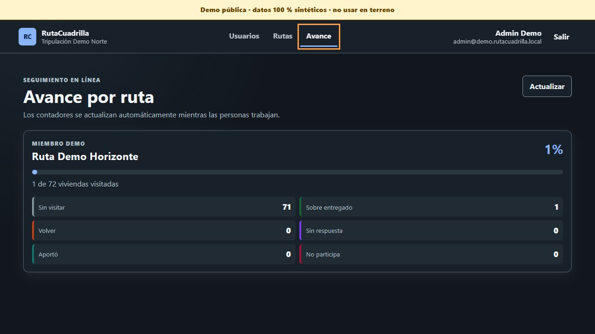
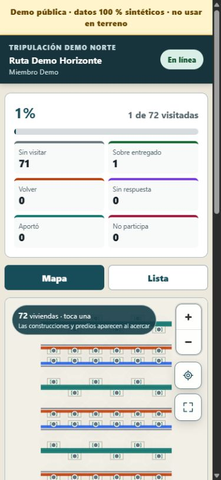
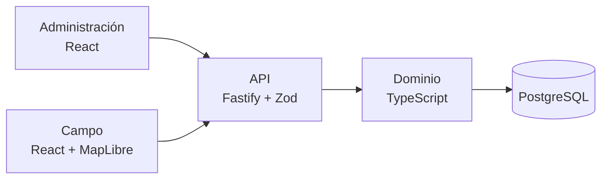

# RutaCuadrilla

[](https://github.com/xSkyLiN3/rutacuadrilla/actions/workflows/quality.yml)
[](https://nodejs.org/)
[](LICENSE)

Sistema web para asignar recorridos a equipos de terreno y registrar el avance
punto por punto. Combina una consola administrativa, una experiencia móvil de
campo, una API con reglas transaccionales y persistencia PostgreSQL.

> **English summary:** full-stack geospatial field-operations prototype with
> transactional assignment rules, optimistic concurrency and a reproducible
> synthetic demo.

> **Edición pública de portafolio:** todos los nombres, domicilios,
> coordenadas y polígonos incluidos son 100 % sintéticos. El inventario del
> piloto privado no forma parte del repositorio ni del build.

## Por qué este proyecto es interesante

RutaCuadrilla no se limita a un CRUD con mapa. El dominio exige impedir
solapamientos, aislar la ruta de cada operador, aceptar reintentos sin duplicar
efectos y resolver actualizaciones concurrentes sin perder el estado canónico.

La versión demostrable incluye:

- dos interfaces React adaptadas a roles diferentes;
- importación y publicación idempotente de rutas CSV;
- una asignación activa por usuario y exclusividad de puntos;
- seis resultados operacionales por visita;
- mapa MapLibre y alternativa en lista para móvil;
- control optimista de versiones y respuesta explícita a conflictos;
- avance agregado para administración;
- autenticación, sesiones revocables y rate limiting;
- migraciones, auditoría de cambios, backups y restauración verificada;
- CI reproducible en Ubuntu y Windows.

## Estado real

Es un **prototipo funcional de ingeniería**, no un SaaS ni un producto
certificado para operar con información sensible. Simple Online es la
experiencia canónica. Los módulos de campañas y sincronización local-first se
conservan como investigación técnica bajo el perfil explícito `full`, pero no
son parte de la demo ni de las promesas del producto.

## Producto en funcionamiento

Administración refleja el avance agregado de la ruta en línea:



Campo ofrece el recorrido, sus 72 viviendas y una alternativa en lista desde
un viewport móvil:



Las capturas se generaron mediante el flujo local reproducible. En la prueba
E2E, registrar una visita en Campo actualizó el contador de Administración de
`0/72` a `1/72`; no se usó información del piloto privado.

## Arquitectura



El perfil predeterminado de la API es `simple`: expone autenticación, salud y
los endpoints utilizados por Administración y Campo. La pertenencia, las
versiones y la exclusividad se validan en servidor y base de datos.

Más detalle en [docs/architecture.md](docs/architecture.md).

## Demo local reproducible

Requisitos: Node.js 24+ y npm 11+.

```powershell
npm ci
npm run demo:check
npm run demo:start
```

En Bash se usan exactamente los mismos comandos:

```bash
npm ci
npm run demo:check
npm run demo:start
```

`demo:start` valida el entorno, inicia API, Administración y Campo, espera su
readiness y carga la ruta sintética de forma idempotente. Si `.env` no existe,
lo crea desde `.env.demo.example`; si ya existe y difiere, se detiene sin
sobrescribirlo ni mezclar configuraciones. `Ctrl+C` cierra solo los procesos
iniciados por el comando.

- Administración: <http://127.0.0.1:4311/>
- Campo: <http://127.0.0.1:4312/>
- Readiness: <http://127.0.0.1:4310/ready>

Al quedar lista, la terminal muestra las dos credenciales públicas necesarias.
También están documentadas en `.env.demo.example` y sirven únicamente para la
base embebida de demostración.

Si prefieres PostgreSQL local, instala o descomprime PostgreSQL 18 y define
`RUTACUADRILLA_POSTGRES_HOME` con la ruta de sus binarios. Después ejecuta
`npm run local:postgres:setup`; las credenciales aleatorias quedan dentro de
`.local/`, fuera de Git.

## Dataset sintético

`npm run demo:generate` produce de forma determinista:

- 72 puntos ficticios;
- 12 segmentos con `LEFT`, `RIGHT` y `BOTH`;
- un área de referencia;
- 72 predios y 72 huellas sintéticas con relación 1:1;
- un manifiesto con semilla, conteos y hashes SHA-256.

`npm run demo:check` comprueba que los artefactos versionados coincidan byte a
byte con el generador. Consulta [demo/README.md](demo/README.md) y
[DATA_SOURCES.md](DATA_SOURCES.md).

## Calidad y seguridad

```powershell
npm run verify
npm audit --omit=dev --audit-level=high
```

El contrato `verify` ejecuta formato, lint, tipos, escaneo de secretos y
material privado, pruebas automatizadas y los cuatro builds. La configuración
de despliegue añade secretos desde archivos, red privada para PostgreSQL,
contenedores de solo lectura y capacidades mínimas.

Las limitaciones y el modelo de amenaza están en
[docs/security-and-privacy.md](docs/security-and-privacy.md) y
[SECURITY.md](SECURITY.md).

## Stack

- TypeScript, React 19 y Vite 8.
- Fastify 5 y Zod 4.
- PostgreSQL 18, PGlite y SQLite Wasm para experimentación local.
- MapLibre GL JS.
- Vitest, Testing Library y Node Test Runner.
- Docker Compose, Caddy y Nginx.
- Biome y GitHub Actions.

## Documentación

- [Producto y alcance](docs/product.md)
- [Arquitectura](docs/architecture.md)
- [Desarrollo local](docs/development.md)
- [Seguridad y privacidad](docs/security-and-privacy.md)
- [Operación y despliegue](docs/operations.md)
- [Decisiones de arquitectura](docs/README.md)

## Limitaciones conocidas

- La demo pública usa información sintética y no acredita validación comercial.
- No optimiza recorridos ni utiliza IA/ML.
- El modo offline/local-first permanece experimental.
- El mapa base externo es opcional y no se configura por defecto.
- La referencia Compose todavía comparte el rol PostgreSQL de migración y
  runtime; un despliegue sensible debe separar propietario y rol DML.
- Un despliegue real necesita evaluación legal, privacidad, monitoreo,
  restauración ensayada y revisión de seguridad independiente.

## Licencia

El código original se publica bajo [MIT](LICENSE). La licencia no cubre mapas,
servicios o datos de terceros configurados por quien despliegue la aplicación.
