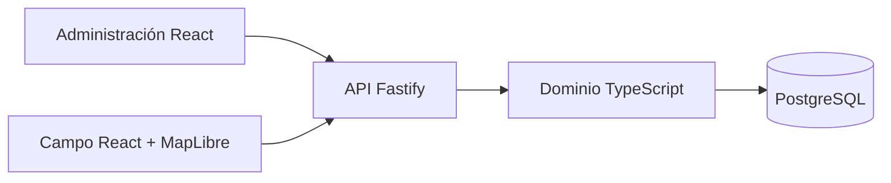

# Arquitectura

## Vista canónica

El producto ejecutable es un monolito modular con dos clientes web. La API
mantiene autenticación, autorización y reglas transaccionales; los clientes no
deciden pertenencia, exclusividad ni versiones canónicas.

## Módulos

### Administración

- gestiona usuarios operativos;
- importa rutas desde un contrato CSV validado;
- asigna o retira una ruta activa;
- consulta totales por estado.

### Campo

- consume únicamente la asignación de la persona autenticada;
- representa puntos y segmentos en mapa o lista;
- envía una operación idempotente con versión esperada;
- resuelve conflictos mostrando el estado canónico del servidor.

### API

- Fastify con validación Zod;
- sesiones firmadas y revocables;
- rate limiting de inicio de sesión;
- cabeceras defensivas y logs con campos sensibles redactados;
- perfil `simple` para exponer solo la superficie usada por la experiencia
  principal.

### Persistencia

- PostgreSQL como almacenamiento de despliegue;
- once migraciones ordenadas que el runner aplica una sola vez y protege con
  checksum;
- consultas parametrizadas;
- eventos de actualización e importaciones con claves idempotentes;
- restricciones para evitar duplicidad y solapamientos inválidos.

## Decisiones destacables

- Izquierda y derecha se interpretan respecto al orden de coordenadas de un
  segmento, no respecto a un punto cardinal.
- El cliente nunca asigna una vivienda por proximidad o numeración par/impar.
- Los estados se separan de datos personales y montos por domicilio.
- Los catálogos visuales son opcionales; la ruta operativa proviene de la API.

## Perfil experimental

El código conserva componentes investigativos de campañas y sincronización
local-first. El perfil explícito `full` amplía únicamente la superficie de la
API para investigación y pruebas; los entrypoints web siguen montando las
experiencias Simple. No forma parte de la demo ni de las afirmaciones del
producto canónico.
